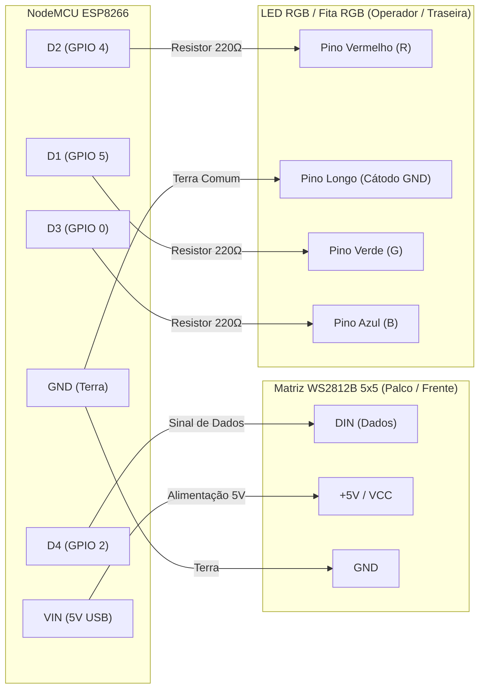

# vTally Light - Wireless Tally System

Sistema completo de Tally Light sem fio para **OBS Studio** e **Blackmagic ATEM**, baseado em hardware acessível com **ESP8266 (NodeMCU)**. 

O sistema conta com iluminação dupla independente:
- **LED do Operador:** LED RGB ou fita de LED RGB (4 vias, cátodo comum `grb-` ou ânodo comum `grb+`).
- **Luz de Palco / Apresentador:** Matriz de 25 LEDs endereçáveis **WS2812B 5x5** (ou fita de LED endereçável cascateada).

---

## Recursos Principais

- **Compatibilidade Nativa com OBS Studio:** Integração via OBS WebSocket.
- **Suporte a Blackmagic ATEM:** Conexão direta com mixers ATEM via rede local.
- **Painel de Configuração Web Embutido:** Interface moderna acessível em `http://localhost:3000/tally-setup`.
  - Simulador visual em tempo real da matriz 5x5.
  - Botões de teste rápido na placa física (Preview, Program, Boot, Apagar).
  - Gravador serial via USB integrado no próprio navegador (gravação rápida de configurações ou instalação completa de placas virgens com 1 clique).
- **Firmware Otimizado para ESP8266:**
  - Cores calibradas para evitar distorção óptica.
  - Isolamento completo entre as luzes de operador e palco (o operador pode ficar em preview enquanto a matriz desliga, se configurado).

---

## Download Rápido (Executável Pronto para Windows)

Não é necessário instalar Node.js ou compilar o código para usar o vTally Hub.
1. Acesse a aba [**Releases**](https://github.com/lelobalbinotti/tally-light/releases).
2. Baixe o arquivo `vTally-Studio-Release.zip`.
3. Extraia a pasta e execute `vTally Hub.exe`.
4. O servidor iniciará automaticamente na porta `3000`.

---

## Esquema de Ligação Física do Hardware

A placa controladora é o **NodeMCU ESP8266** (módulo ESP-12E com chip serial CH340 ou CP2102). O sistema foi projetado para operar com alimentação padrão de 5V via porta Micro-USB (powerbank, porta USB da câmera ou carregador de celular).

### Diagrama Geral de Conexões

```text
                 +-----------------------------------+
                 |          NodeMCU ESP8266          |
                 |                                   |
                 | [USB 5V]                          |
                 |                                   |
(Matriz 5x5 DIN) | D4 (GPIO 2)                  VIN  | ---- +5V (VCC da Matriz 5x5)
                 |                                   |
(LED RGB Verde)  | D1 (GPIO 5)                  GND  | ---- GND Comum (Matriz + LED RGB)
(LED RGB Verm.)  | D2 (GPIO 4)                       |
(LED RGB Azul)   | D3 (GPIO 0)                  3V3  | ---- (Uso se LED RGB for Ânodo Comum)
                 +-----------------------------------+
```



---

### Opções de Montagem do Hardware

O firmware suporta diferentes configurações de hardware. Abaixo estão as opções disponíveis e os ajustes correspondentes no arquivo `tally-settings.ini`:

#### Opção 1: Matriz 5x5 no Palco + LED RGB no Operador (Recomendada)
Configuração padrão profissional. O apresentador enxerga a matriz brilhante de 25 LEDs na frente da câmera, e o operador conta com um LED piloto discreto na traseira.
- **Palco (Frente):** Matriz WS2812B conectada ao pino **D4**.
- **Operador (Traseiro):** LED RGB (ou fita de LED RGB de 4 vias) nos pinos **D1 (G), D2 (R), D3 (B)**.
- **Configuração no `tally-settings.ini`:**
  ```ini
  operator.type=grb-
  operator.ws2812=0 grb
  stage.ws2812=25 grb
  ```

#### Opção 2: Matriz WS2812B no Operador (Sem Matriz no Palco)
Se você preferir utilizar a matriz 5x5 voltada exclusivamente para o operador de câmera (ou dentro do visor):
- **Conexão:** Matriz WS2812B conectada ao pino **D4**.
- **Configuração no `tally-settings.ini`:**
  ```ini
  operator.type=grb-
  operator.ws2812=25 grb
  stage.ws2812=0 grb
  ```

#### Opção 3: Duas Matrizes WS2812B Cascateadas (Palco + Operador)
Para usar uma matriz 5x5 na frente e outra matriz 5x5 atrás:
- **Conexão:** 
  1. Conecte o pino **D4** do NodeMCU no **DIN** da 1ª matriz (Palco).
  2. Conecte o pino **DOUT** da 1ª matriz no **DIN** da 2ª matriz (Operador).
  3. Alimentação (+5V e GND) em paralelo para ambas as matrizes.
- **Configuração no `tally-settings.ini`:**
  ```ini
  operator.type=grb-
  operator.ws2812=25 grb
  stage.ws2812=25 grb
  ```

#### Opção 4: Apenas LED RGB ou Fita de LED RGB (Econômica e Compacta)
Modelo ultracompacto para ser acoplado diretamente na sapata da câmera sem a matriz de 25 LEDs (usando um LED RGB avulso ou fita de LED RGB analógica):
- **Conexão:** Apenas o LED RGB / fita RGB nos pinos **D1, D2, D3** e **GND**.
- **Configuração no `tally-settings.ini`:**
  ```ini
  operator.type=grb-
  operator.ws2812=0 grb
  stage.ws2812=0 grb
  ```

---

### Pinagem Detalhada dos Componentes

#### 1. LED RGB (4 Pinos) ou Fita de LED RGB Analógica
Pode ser utilizado tanto um LED RGB difuso quanto fitas de LED RGB analógicas comuns (com linhas R, G, B e Comum):

```text
       +-------+
      /  LED    \
     |   RGB     |
     +-----------+
       |   |   |   |
       |   |   |   |
      (1) (2) (3) (4)
       R   COM  G   B
```

| Terminal / Fio da Fita | Identificação | Conexão no NodeMCU | Observação |
| :--- | :--- | :--- | :--- |
| **Pino 1 / Linha R** | Vermelho (R) | **D2** (GPIO 4) | Usar resistor de 220Ω ou 330Ω em série |
| **Pino 2 / Comum** | Comum (Perna longa ou Comum) | **GND** (Cátodo `grb-`) ou **3V3/5V** (Ânodo `grb+`) | Define o tipo no painel ou no `.ini` |
| **Pino 3 / Linha G** | Verde (G) | **D1** (GPIO 5) | Usar resistor de 220Ω ou 330Ω em série |
| **Pino 4 / Linha B** | Azul (B) | **D3** (GPIO 0) | Usar resistor de 220Ω ou 330Ω em série |

#### 2. Matriz Endereçável WS2812B 5x5 (25 LEDs)
| Pino da Matriz | Conexão no NodeMCU | Função |
| :--- | :--- | :--- |
| **+5V / VCC** | Pino **VIN** (5V da porta USB) | Alimentação elétrica da matriz |
| **GND** | Pino **GND** do NodeMCU | Terra comum de dados e energia |
| **DIN** | Pino **D4** (GPIO 2) | Entrada de dados seriais em alta velocidade |
| **DOUT** | Opcional | Saída de dados (usada apenas se cascatear para outra matriz) |

> **Dica de Alimentação:** Para até 25 LEDs operando com brilho entre 10% e 30%, a alimentação direta pelo pino `VIN` da porta USB do NodeMCU é mais que suficiente e segura. Se for utilizar múltiplas matrizes com brilho máximo, utilize uma fonte 5V dedicada conectando o polo negativo (GND) junto ao GND do NodeMCU.

---

## Estrutura do Repositório

```text
├── firmware/         # Firmware base NodeMCU (.bin), SPIFFS e scripts Lua corrigidos
├── hub/              # Código-fonte do vTally Hub, rotas de API, ponte OBS e tray
├── configurator/     # Interface web do configurador, simulador e servidor auxiliar
├── config/           # Modelo limpo de configuração (tally-settings.example.ini)
└── README.md         # Documentação do projeto
```

---

## Configuração do Tally (`tally-settings.ini`)

As configurações são salvas diretamente no sistema de arquivos do ESP8266:

```ini
tally.name=Cam1
station.ssid=Nome_Da_Sua_Rede_WiFi
station.password=Senha_Do_WiFi
station.ip=192.168.1.50        ; Opcional (deixe vazio para DHCP automático)
station.gateway=192.168.1.1
station.netmask=255.255.255.0
hub.ip=192.168.1.100            ; IP do computador onde roda o vTally Hub
hub.port=7411                  ; Porta padrão UDP
operator.type=grb-             ; grb- (cátodo comum) ou grb+ (ânodo comum)
operator.ws2812=0 grb          ; 0 se usar LED RGB / fita analógica
stage.ws2812=25 grb            ; Quantidade de LEDs na matriz (ex: 25)
brightness=20                  ; Brilho (1 a 100%)
```

---

## Como Gravar ou Atualizar as Placas

1. Conecte o NodeMCU ao computador via cabo USB.
2. Abra o vTally Hub e acesse `http://localhost:3000/tally-setup`.
3. Selecione a porta serial (**COM**) correspondente.
4. Defina o nome da câmera (ex: `Cam1`, `Cam2`) e as informações de rede.
5. Clique em:
   - **Instalar Firmware e Configurar Placa Nova:** Para placas de fábrica sem firmware prévio.
   - **Gravar na Placa e Reiniciar:** Para placas que já possuem o NodeMCU e precisam apenas atualizar as configurações ou o script de iluminação.

---

## Créditos e Origem

Este projeto é uma adaptação e evolução baseada no projeto de código aberto [vTally](https://github.com/wifi-tally/wifi-tally) criado originalmente por [xopn.de](https://github.com/wifi-tally).

**Principais melhorias e adições desta versão:**
- Compatibilidade nativa com **OBS Studio 30** via WebSocket v5.
- Aplicativo portátil para Windows (`vTally Hub.exe`) com controle na bandeja do sistema e inicialização automática da interface web.
- Painel integrado de configuração e gravação serial via USB no navegador (`/tally-setup`).
- Firmware otimizado para matrizes de LED endereçáveis **WS2812B 5x5** e LEDs RGB.
- Calibração de cores e distinção clara de estados: Programa (vermelho), Preview (verde), Standby (azul suave).

---

## Licença

Este projeto é distribuído sob a licença [MIT](LICENSE).
